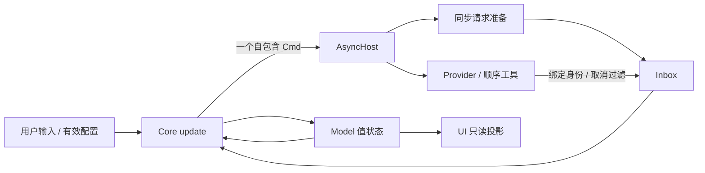
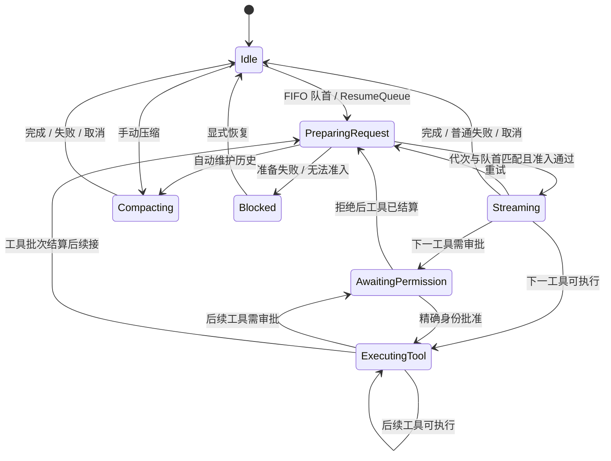

# Runtime 架构

2026-10-10：本文说明当前合同。2026-10-09 的架构精简决策、删除及验证见[精简决策及实施记录](ARCHITECTURE-SIMPLIFICATION-DECISIONS-2026-10-09.md)；[上一阶段实施方案](RUNTIME-ARCHITECTURE-REFACTOR-PLAN.md)和[上一阶段验证记录](RUNTIME-REFACTOR-VALIDATION.md)保留各自历史边界。本次等价代码瘦身见文末记录。

`update(Model, Msg) -> Step{Model, Cmd}` 是唯一的纯状态转换入口。每次返回一个数据化 Cmd；Core 不持有线程、共享取消令牌、时钟或执行依赖。Host 在 owner thread 提交新 Model，然后执行 Cmd。单会话工具按顺序执行，同一时刻只有一个逻辑活动操作。

## 状态和身份

`Model` 组合 `phase`、`domain` 和 `session`。`domain` 保存 Thread、profile 和构造时校验的 RequestPolicy；`session` 保存 FIFO 草稿队列、ID 序列、用量、投影校准账本、压缩失败记录和流采样。采样在流结束后仍可供 UI 读取。

阶段及其生命周期数据定义在 `phase.hpp`：

| 阶段 | 数据与退出条件 |
| --- | --- |
| Idle | 无活动逻辑操作；队列非空时进入准备 |
| PreparingRequest | PreparationId + 三选一 RequestIntent；准备结果必须匹配代次及当前队首 |
| Streaming | StreamRef、assistant 锚点、receipt、usage_accepted、可选回滚 user 锚点 |
| AwaitingPermission | 完整 ToolCallRef；只有精确匹配的审批能推进 |
| ExecutingTool | 同一个 ToolCallRef；结果还须匹配已绑定的 ToolRef |
| Compacting | 启动时捕获的 CompactionPlan、待验证摘要和 usage_accepted |
| Blocked | 原因、可选预算诊断与提示；显式恢复后重新准备队首 |

`OperationRef = variant<StreamRef, ToolCallRef, CompactionId>` 是取消和用量共用的身份表示。StreamRef 同时包含 TurnId 和 StreamId；ToolCallRef 同时包含 assistant MessageId 和 ToolExecId。ID 在线性 Model/Host 会话内单调分配，不复用。Core 拒绝零值、缺失、不匹配和已经退出阶段的异步身份。

原始 ProviderEvent 尚未绑定会话身份，可以使用默认值。Host 根据执行命令的快照覆盖身份、fingerprint，并解析工具名称，再投递 Core 消息；无身份事件不能直接进入 Core 并生效。

图展示主线；权限拒绝可推进下一工具，取消和会话级错误可从活动阶段提前退出。图中 Idle 的队列推进可以在同一次转换内直接返回 PrepareRequest；完整回合包括工具与后续 stream。取消先撤销旧 Phase 身份，再推进队列或发 CancelOperation。Stream 的 provider 上下文拒绝只有在明确允许回滚、尚无正文或工具调用且 user/assistant 锚点匹配时回滚空的新回合。

## 执行与取消

AsyncHost 只有一个可选的 `CurrentOperation{OperationRef, shared_ptr<OperationState>}` 取消槽位。PrepareRequest 先作废旧槽位，再读取动态 prompt 和工具目录；StartStream、StartCompaction、RunTool 先作废旧槽位，再建立新句柄。CancelOperation 仅在完整身份相等时作废槽位；NoCommand 保留槽位。

槽位仅由 owner thread 操作。worker 自行持有 state、inbox、运行时依赖和命令快照的所有权；Host 放弃引用后，旧任务仍能安全收尾。正常完成的轻量句柄可保留到下一次替换。shutdown 只设置 WorkPool 的共享停止信号并唤醒 owner，不访问槽位，因此可从其他线程调用。

Host 过滤取消后的回调；Core 拒绝取消前已入队的迟到消息。process_msg 只有 update、提交 Model、执行 Cmd 三步。provider 的异常转换、终态去重、缺失终态补错和停止检查共用一个私有执行骨架，流和压缩各自翻译事件。没有任务退出消息、退休协议或 effect batch。

逻辑取消隔离会话状态；已经发生的工具副作用不会撤销。卡住的隔离工具线程可在 Host 退出后继续持有资源；共享池中的 provider 若永不返回，析构 join 仍可能等待。`run_until_quiescent` 依据 Core 的 Idle / AwaitingPermission / Blocked 判断业务静止，不承诺所有后台任务已退出。

## 工具解析与执行

Host 将原始 StreamToolCall 解析为 ResolvedStreamToolCall。该消息不能默认构造或省略解析结果；只允许显式绑定或解析失败，构造时拒绝零 ToolRef（包括空 variant 产生的假成功）。未知工具继续保留原始调用字段及明确错误。Core 先匹配完整 StreamRef，再将这两个结果直接转换为 Pending 或 Failed；没有“Host 未解析”的第三态。Pending 的绑定完整性防护仍用于检查领域状态。

AsyncHost 的工具执行只有 ToolRuntime 注册 handler 一个入口。handler 接收原始参数和取消上下文；ToolRuntime 转换标准/非标准 handler 异常，Host 保留对运行时调用本身错误的防护。ToolExecOutput 直接携带 ToolCallRef、ToolRef、ExecResult；Core 同时匹配活动调用和绑定，再结算结果。不存在报告包装、无消费者时长/输出字节统计或 Host 备用执行函数。

工具批次结算后，kick_pending_tools 用当前 assistant 的 turn_id/id 直接创建续接意图。串行阶段保证此时没有另一个合法的更晚 assistant；身份在请求准备修改状态前复制，不再反向扫描历史。finish_turn、drive、start_request_preparation 继续集中表达回合结束、FIFO 和准备规则。

## 请求准备与配置

RequestIntent 只能是 QueuedTurnRequest、ToolContinuationRequest 或 RetryRequest。新回合准入后才提交队首并创建 assistant；续接创建新 assistant；重试复用目标 assistant。准备失败时，新回合保留队首并阻塞，续接和重试给原 assistant 记录错误后推进队列。

`canonical_request(const Thread&)` 同时读取消息和已接受压缩；未提交队首由 Core 在其后追加到草稿。不存在可误配独立 Request 与 Thread 的公共投影接口。压缩候选投影只在 compaction.cpp 内部用于验证。

Host 准备动态 prompt、工具目录和输出预算，完成上下文投影及准入判断，返回 `PreparedRequestSnapshot{request, budget, receipt}`。三项在同一次计算中产生；Core 接受后将该完整请求交给 StartStream，执行时不重新准备。估算预算用于准入和诊断，真实 UI 用量来自 provider 观测。

RequestPolicy 封装 ContextManagementConfig、provider name 和 model，构造时调用原 validate，只提供只读访问。非法值在 dispatch/update 之前抛出原有异常，不会先移走 Host 的 Model。准备中修改配置会分配新的 PreparationId；正在执行的 Stream 和 CompactionPlan 保持启动快照，后续请求读取新配置。压缩规划只有一个入口，可复用准备时已有的 assessment。

上下文投影只有一个完整公共入口。裁剪直接生成最终 Request，预算和分配是算法局部值，裁剪摘要保留在标记中；没有按工具复制文本的明细报告。投影的 projected_input_tokens 是准入输入，estimated 是预算质量的唯一表示，预算报告仅保留实际用于准入和 UI debug 的值，原始 realistic_input_tokens 仍用于 receipt 校准。Core 在用量接受处匹配 operation/fingerprint 并保证一次接受；anchor 只保存校准计算需要的信息，不再重复携带这两项身份。手动规划可以计算尚未提供的 assessment，自动规划复用准备结果，不再为已生成的零值报告重复重算。

segment 的版本统一归其所属 Projection/Receipt/Anchor 集合：唯一 manifest 一次生成，receipt 和 anchor 整体复制，没有混合版本生成路径。先匹配外层 provider/model/estimator/policy（含工具裁剪 fingerprint），再校验逐段内容身份。receipt 与 anchor 有观测前后不同的生命周期，保留各自外层版本。压缩保留启动时 RequestPolicy、源请求/摘要/覆盖边界、发出请求 fingerprint 和预算验证；输出预算直接从 compaction_request 检查，没有另一份 summary_output_budget。

## 用量

Core 先验证活动身份、fingerprint 和阶段内 usage_accepted，再调用 usage 模块的 `record_accepted`；普通请求与压缩共用 token 规范化及累加规则。工具分支不能作为模型用量接受。Exact 观测继续通过纯算法校准投影账本。

UsageState 保存 session totals、compaction totals、当前 turn totals、latest_request 和 observed_context。压缩计入 session 和 compaction totals，不改变 turn、最近普通请求或真实上下文观测。当前 turn 的质量从 latest_request 的 StreamRef.turn_id 推导，不再保存第二份 latest_request。

新请求使 Exact 上下文变为 Last；请求终态缺少用量时，latest_request 标记 Unavailable，同时保留较早的真实观测并标记 Stale。不会把估算准入值当作真实 token 数。

## UI 状态与屏幕

project_screen 每次从当前 Model 读取请求、回合、上下文用量和质量，直接构建状态栏。UiState.status 只保存外部展示配置与 rate/time telemetry；编辑、时钟采样、LiveTokenRate 和 TokenRateHistory 仍需跨帧保存。UI 循环不投影或缓存用量，屏幕也不创建临时 UiState 或复制速率历史作为中转。Unavailable、Last、Stale、真实观测与预算估算继续保持不同展示语义。项目只使用 Maya 渲染器，仍自行驱动事件循环。

## 阅读路径

1. `identity.hpp`、`phase.hpp`、`model.hpp`：身份、阶段和状态归属。
2. `agent.cpp`：drive → start_request_preparation → accept_prepared_request → kick_pending_tools / finish_turn / cancel_active。
3. `async_host.cpp`：消息泵、取消槽位和执行输入快照。
4. `request_preparation.cpp`、`context.cpp`、`compaction.cpp`：准备与纯算法。
5. `usage.hpp / usage.cpp`：用量值及更新规则；`ui/screen.cpp` 在屏幕构建时读取这些事实。

## 2026-10-10 等价代码瘦身

本次整理沿用上述合同及 D1–D9 的行为边界。`agent.cpp` 将六个单纯递增 ID 的私有包装、一次性读取 turn ID 和转换压缩失败类别的包装放回调用处；取消消息直接处理原有取消逻辑。回滚空回合只定位一次 assistant，仍检查零 ID、空正文及工具、末尾位置和前一条 user 的身份。`finish_turn`、`drive`、`start_request_preparation` 等承载业务转换的函数保留。

Host 的取消命令直接匹配当前操作，再调用统一的 `invalidate_current_operation`。上下文估算和 Provider 错误识别移除单纯转发的私有函数。UI 的 `run_ui` 用一个完整入口及默认参数支持既有调用；重绘时钟仅以可选 deadline 表示待绘请求，保留原有时间合并规则。工具注册工厂直接返回唯一的 skill 工具；无调用者的三个 `SessionServices` 访问器及旧 `tool.hpp` 兼容头删除。各项均使用既有公开行为测试验证，未增加内部结构断言。

本次在 `/root/agent_learning/build` 取得新基线：全项目构建通过，获准网络环境的完整回归 535/535 通过。四个切片的相关测试分别为 89/89、82/82、41/41、71/71 通过。最终执行 `cmake --build /root/agent_learning/build -j 3` 和 `ctest --test-dir /root/agent_learning/build --output-on-failure -j 4 --timeout 90`，全项目构建通过，完整回归 **535/535 通过、0 失败、0 跳过**；测试名称与新基线一致。沙箱内基线因 socket 权限有 1 项失败、9 项网络跳过，获准环境重跑已通过。构建仍有 `nlohmann/json` 的既有弃用警告。未进行人工 TUI 验收；PTY 自动测试已执行。既有本地 Maya 修改在本次前后相同。
